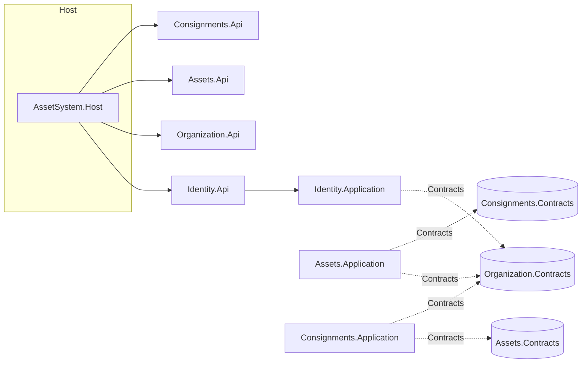
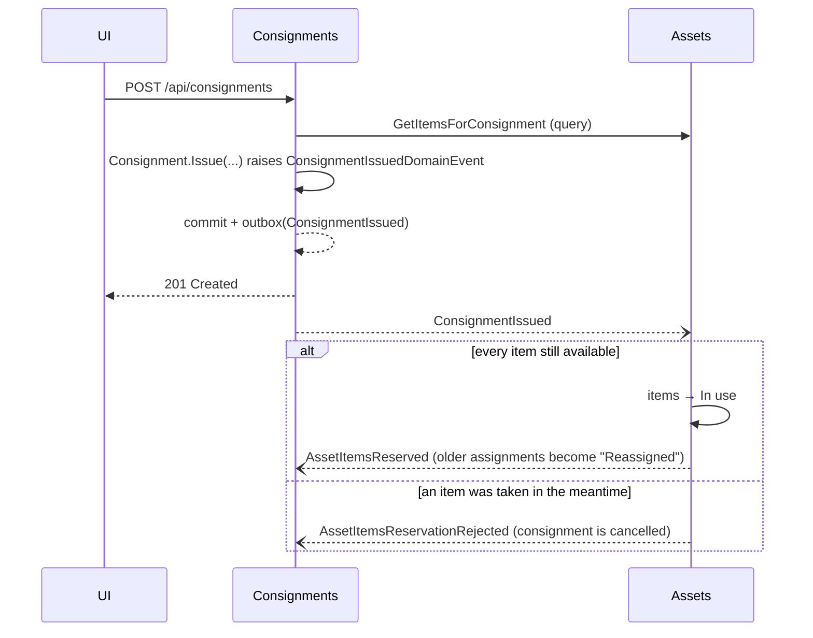

# Architecture

## Goals

* **Modular monolith**: one deployable, but modules that could be split out later because they only meet at explicit contracts.
* **Clean architecture** inside every module: dependencies point inwards, the domain knows nothing about databases or HTTP.
* **DDD**: aggregates guard invariants; business rules live in the domain, not in controllers or handlers.
* **Vertical slices**: a feature is a folder (command/query + validator + handler + endpoint), not a horizontal layer of controllers.
* **WolverineFx** is the in-process mediator *and* the messaging backbone, with a PostgreSQL-backed transactional outbox.

## Modules

| Module | Responsibility | Talks to |
| --- | --- | --- |
| Identity | users, passwords, JWT, roles, company access | Organization (company names) |
| Organization | companies, branches, departments, employees, suppliers, item types | – |
| Assets | assets and their items, numbering, documents, depreciation, dashboard | Organization, Consignments |
| Consignments | issuing items to employees, receiving copy, history | Organization, Assets |

Each module is five projects:

```
AssetSystem.<Module>.Contracts       messages other modules may use (queries, integration events) – no dependencies
AssetSystem.<Module>.Domain          aggregates, value objects, domain events, invariants      → SharedKernel
AssetSystem.<Module>.Application     use cases (slices), abstractions (repositories, queries) → Domain, Contracts
AssetSystem.<Module>.Infrastructure  EF Core, PostgreSQL, migrations, implementations         → Application
AssetSystem.<Module>.Api             minimal-API endpoints, one class per slice               → Application
```

`tests/AssetSystem.ArchitectureTests` enforces these rules (domain is framework free, application never references
infrastructure or ASP.NET, modules reference each other **only** through `Contracts`).



## A vertical slice

`Assets.Application/Features/RegisterAsset/RegisterAsset.cs` holds, in one file:

```csharp
public sealed record RegisterAssetCommand(...);                    // the request
public sealed class RegisterAssetValidator : AbstractValidator<…>; // FluentValidation, run by Wolverine middleware
public static class RegisterAssetHandler { Task<Result<…>> Handle(command, deps…) }   // the use case
```

and `Assets.Api/Features/RegisterAsset/RegisterAssetEndpoint.cs` maps `POST /api/assets` to
`bus.InvokeAsync<Result<…>>(command)` and turns the `Result` into HTTP. Add a feature = add a folder; nothing else to register
(handlers are discovered by Wolverine, endpoints by `IEndpoint`, validators by assembly scan).

Writes go through aggregates (`IAssetRepository` + `IAssetsUnitOfWork`); reads are projections straight from the
database (`IAssetQueries`), so lists never load aggregates.

## Messaging between modules

* **Queries across modules** are Wolverine request/reply messages defined in the other module's `Contracts`
  (`bus.InvokeAsync<BranchDto?>(new GetBranch(...))`). The handler lives in the owning module.
* **Events** are published through the **transactional outbox**: the aggregate change and the message are committed in
  the same PostgreSQL transaction (`IDbContextOutbox<T>` in `UnitOfWork`), and processed from durable local queues, so a
  message is never lost and never sent for a rolled-back change. Domain events raised by aggregates are collected by the
  unit of work; an Application handler maps them to public integration events.

Issuing a consignment:



The consignment therefore reaches its final state a moment after the request returns (eventual consistency); the UI
refreshes related data and the integration tests poll for it.

## Data

One PostgreSQL database, **one schema per module** (`identity`, `organization`, `assets`, `consignments`, plus
`wolverine` for the message store) and one `DbContext` + migrations per module. There are no foreign keys across
schemas: modules reference each other by id only, so each could move to its own database.
Audit columns (created/updated by/at) are stamped by an EF interceptor.

Notable constraints live in the database as well as the domain: unique item codes, unique serial numbers and keys per company
(partial indexes that ignore `N/A`), unique asset numbers and consignment numbers.

## Security

JWT bearer tokens (`sub`, `name`, `role`, `company_id`). A user signs in, then selects a company; endpoints behind the
`CompanySelected` policy only ever see data of that company, because every query takes the company id from the token.
Administrator-only endpoints use the `Administrator` / `CompanyAdministrator` policies. Sign-in is rate limited,
accounts lock after repeated failures, uploads are type- and size-checked and stored under random keys.

## Front end (`web/`)

React 19 + TypeScript + Vite, Tailwind CSS v4, TanStack Query for server state, React Router, react-hook-form + zod.
Organised like the back end, by feature:

```
src/app/        shell (sidebar on desktop, bottom tab bar on phones), routing, navigation
src/shared/     api client, UI kit (Button, Field, Modal, ResponsiveTable …), small helpers
src/features/   auth, dashboard, assets, consignments, employees, admin, organization
                each: api.ts (queries/mutations) · types.ts · components/ · pages/
```

Mobile first: single column layouts that grow with `sm:`/`md:`/`lg:`, 44 px touch targets, 16 px inputs (no iOS zoom),
tables become cards on phones, dialogs become bottom sheets, safe-area aware tab bar, dark mode follows the OS, and
print styles for asset and consignment pages. Routes are code-split.

## Adding things

* **New feature in a module**: add a folder under `Application/Features/<Name>` and `Api/Features/<Name>`.
* **Change the model**: edit the aggregate/configuration, then
  `dotnet ef migrations add <Name> --project src/Modules/<M>/AssetSystem.<M>.Infrastructure --context <M>DbContext --output-dir Persistence/Migrations`.
  Migrations are applied automatically at startup.
* **New module**: copy the five-project layout, register `Add<Module>Application/Infrastructure` and
  `<Module>ApiModule.Assembly` in `Program.cs`, and add it to the architecture tests' module list.
